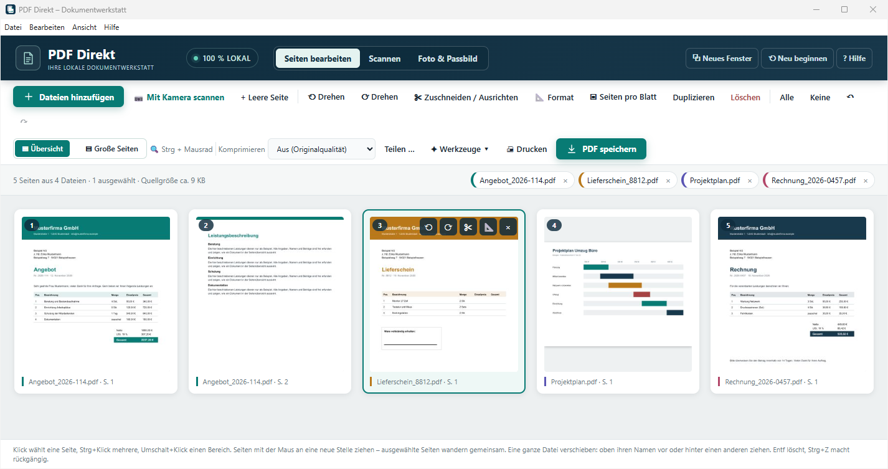
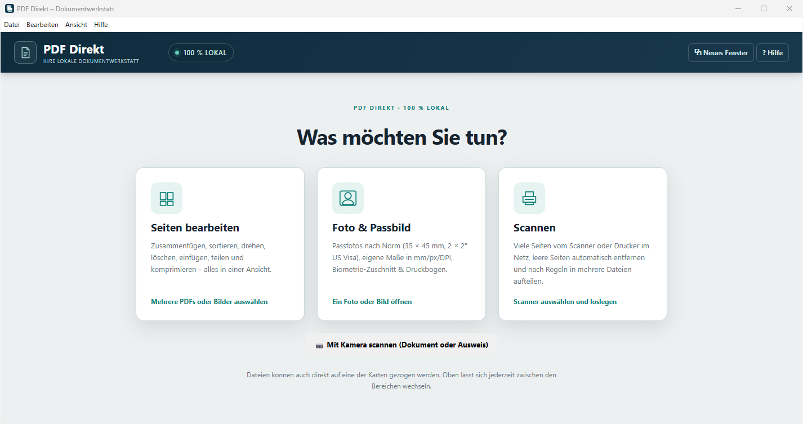
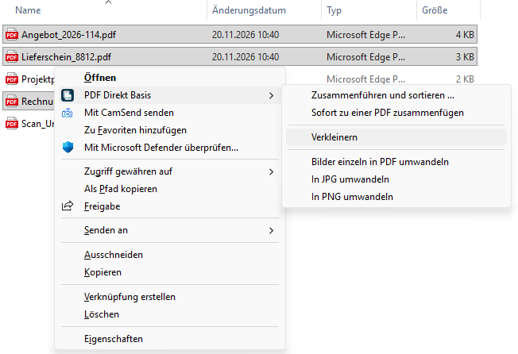
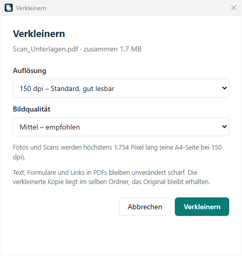
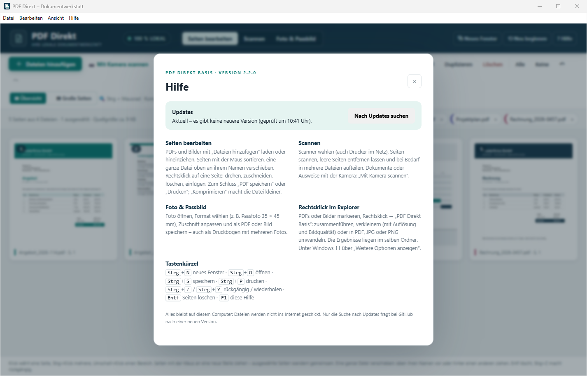

# PDF Direkt Basis

PDF-Seiten zusammenstellen, scannen, drucken und Passfotos erstellen – komplett lokal auf dem eigenen PC (Windows 10 und 11, 64 Bit). Dateien werden nicht ins Internet geschickt.

## Herunterladen und installieren

1. Unter **[Releases → neueste Version](https://github.com/Peyman0117/PDF-Direkt-Basis/releases/latest)** die Datei `PDF-Direkt-Basis-Setup-….exe` herunterladen.
2. Meldet der Browser „wird selten heruntergeladen“: **… → Beibehalten**.
3. Setup starten. Erscheint „Der Computer wurde durch Windows geschützt“: **Weitere Informationen → Trotzdem ausführen** (das Setup ist nicht digital signiert).
4. Im Installations-Assistenten „Nur für mich“ übernehmen – dann sind keine Administratorrechte nötig, auch nicht für Updates.

## So sieht es aus

Die Dokumente in den Bildern sind erfundene Beispiele.

**Startseite** – Seiten bearbeiten, Foto & Passbild oder Scannen wählen.

**Rechtsklick im Explorer** – PDFs oder Bilder markieren, Rechtsklick → „PDF Direkt Basis“: zusammenführen, verkleinern oder umwandeln, ohne die App zu öffnen. Unter Windows 11 steht das Menü unter „Weitere Optionen anzeigen“.

**Verkleinern** – Auflösung und Bildqualität wählen. Die kleinere Kopie liegt im selben Ordner, das Original bleibt erhalten.

**Hilfe und Updates** – Version, Update-Status und Kurzanleitung (Taste F1).

## Updates

Die installierte App sucht selbst nach neuen Versionen (kurz nach dem Start und danach alle sechs Stunden), lädt sie im Hintergrund und installiert sie nach „Jetzt neu starten“ oder beim nächsten Schließen. Von Hand: **Hilfe → Nach Updates suchen**.

## Freie Software

Seitenvorschau, Drucken und das Umwandeln in Bilder nutzen [Poppler](https://poppler.freedesktop.org) (GNU General Public License). Die Lizenztexte und der Quellcode von Poppler liegen bei jedem Release.

Dieses Repository enthält nur die Beschreibung der App; die Downloads liegen unter Releases.
